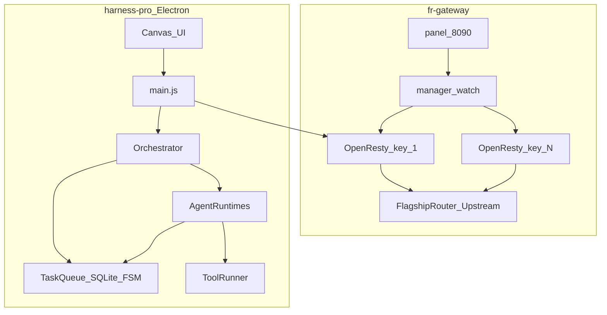

# FLAGGG — Distributed Multi-Agent System

Lokale, autonome Multi-Agenten-Firma: isolierte Gateway-Endpunkte (Docker) und ein Electron-Cockpit mit Task-Queue, Graph-Routing und Self-Healing.

## Architektur



**fr-gateway:** Docker Compose startet Manager + Panel und bis zu ~46 isolierte OpenResty-Container (ein Token/Port). Token-Limits, Failover-Kette, Upstream-Pool.

**harness-pro:** Electron-Desktop. SQLite-Task-Queue, Rollen-Graph, parallele Runtimes (Semaphore), ToolRunner, Synthesizer, Live-Canvas.

## Features

- **Task-Queue + FSM:** `queued → claimed → running → waiting_on_child → done/failed` (strikt)
- **Graph-Routing:** `superiors` / `subordinates` / `peers` — Policy steuert, wer an wen Tasks senden darf
- **Self-Healing-Loop:** Sub-Fehler (`stderr`) → `error_history` → Boss liest Fehler → Fix-Task → Sub heilt (z. B. `pip install`) und wiederholt
- **ToolRunner:** `read_file`, `write_file`, `execute_shell`, `web_search`, `web_fetch`, `download_file`, plus `install_skill` (Plugin-Sandbox)
- **Synthesizer:** Kind-Ergebnisse → kompakter Report (Attention Economy)

## Setup

### 1. Secrets (nie committen)

```bash
cd fr-gateway
cp keys_raw.txt.example secrets/keys_raw.txt
# echte Upstream-Keys eintragen (eine Zeile pro Key)

cp registry.example.json secrets/registry.json
# Ports / unique_key / model_family anpassen
```

Secrets nur über lokale Dateien unter `fr-gateway/secrets/` (gitignored), `.env` oder Docker-Secrets — **niemals** im Repo.

### 2. Gateway starten

```bash
cd fr-gateway
docker compose up -d --build
```

Panel: http://127.0.0.1:8090

### 3. Astra Harness

```bash
cd harness-pro
npm install
npm test
npm run seed-goal   # optional: Demo-Goal in die Queue
npm start
```

Optional: `harness-pro/data/astra-key.txt` mit dem Gateway-Token (Pfad liegt unter `**/data/` und ist gitignored).

### 4. Team-5 Test-Setup (Boss / Architekt + Devs + QA + Docs)

```bash
cd harness-pro
npm run seed-team-5          # schreibt data/desk.json + workspaces/team_repo
npm run team-test            # E2E: Delegation, Self-Heal, Artefakte, Pytest
```

Rollen-Graph: `boss_architect` → 4 Subordinates; Backend↔Frontend Peers; QA↔Docs Peers. Shared Workspace: `workspaces/team_repo`.

## Tests / CI

```bash
cd harness-pro && npm test          # Unit inkl. Team-5-Graph + Skill-E2E
cd harness-pro && npm run team-test # volles 5-Agenten-Szenario (braucht Python/Flask/Pytest)
```

GitHub Actions (`.github/workflows/harness-pro.yml`):

- Job `test` — `npm test`
- Job `team-test` — `seed-team-5` + `npm run team-test`

## Security-Hinweis

- `fr-gateway/secrets/`, `keys_raw.txt`, `**/data/`, `**/logs/`, `**/workspaces/` sind in `.gitignore`.
- Rohe `sk-…` / `vkd-…` Keys gehören nicht in Git, Diffs oder Issues.
- Agent-`execute_shell` läuft im Workspace — nur in vertrauenswürdiger lokaler Umgebung nutzen.

## Legacy

`astra-harness/`, `claude-harness/`, `fr-harness/` sind ältere Kopien und nicht Teil der CI.

## Lizenz

MIT (Harness). Upstream-Zugang und Keys bleiben privat.
